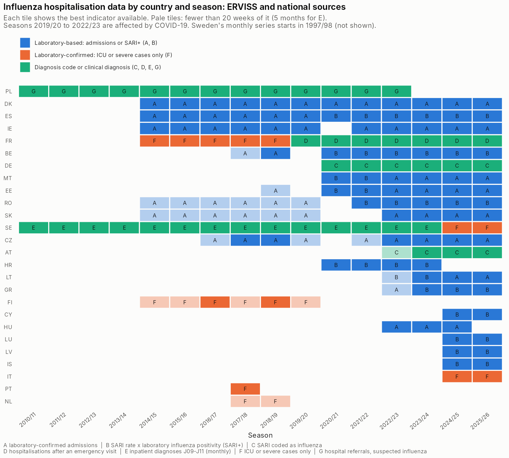
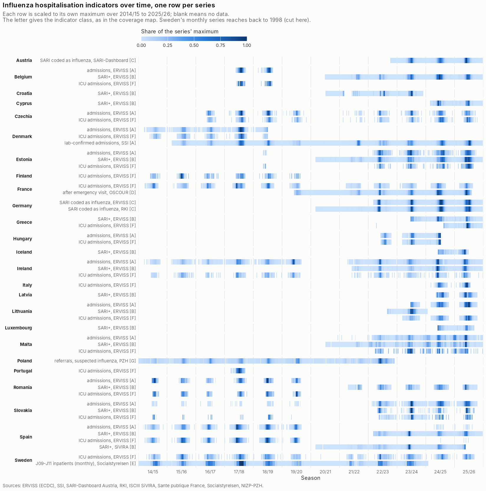

# Influenza hospitalisation indicators

Data need from the [project one-pager](../../README_project.md#data-needs): *diverse influenza hospitalisation
indicators [season, country]*. This folder holds every influenza-specific hospital series we could
find in machine-readable form, cleaned onto one weekly (or monthly) layout. It also documents how they
were found and how far they can be trusted.

## In short

- **26 of the 30 EU/EEA countries** have at least one influenza-specific hospital indicator. Bulgaria,
  Norway, Slovenia and Liechtenstein have none in machine-readable form.
- From 2014/15 on there are **137 full country-seasons** (at least 20 weeks of the indicator):
  - 90 laboratory-based: confirmed admissions, or SARI × laboratory positivity;
  - 35 diagnosis-coded or clinical;
  - 12 ICU only.
- **The backbone is ERVISS:** its hospital, ICU and SARI files, merged across ECDC's dated snapshots,
  reach back to 2014/15 for the hospital and ICU counts.
- **Seven national series** add years or a broader indicator: Denmark, Austria, Germany, Spain,
  France, Sweden and Poland.
- **Laboratory-confirmed admissions over at least 5 seasons:**
  - Denmark and Ireland, 11 seasons each;
  - Czechia, 6 seasons, probably severe cases only;
  - Spain, 6 seasons (2014/15–2019/20), severe cases in sentinel hospitals.
- **The longest series are not laboratory-based:**
  - Sweden: ICD-coded, monthly, from 1997/98;
  - Poland: clinical referrals, 2009/10–2022/23.
- **SARI+ (SARI rate × influenza positivity of SARI samples)** is the most widely shared indicator:
  14 countries, plus Germany's diagnosis-coded equivalent, from 2020/21 at the earliest. Most of them
  have 2 to 6 seasons.

## Descriptive outputs

**Best indicator per country and season**, from
[`coverage_by_country_season.csv`](coverage_by_country_season.csv). Colour gives the kind of evidence
and the letter the exact indicator class (see [Indicator classes](#4-indicator-classes)).



**Every series over time**, one row per series, each scaled to its own maximum. Rows of the same
country stacked together show whether the national and ERVISS series agree on timing.



[`reconciliation_national_vs_erviss.csv`](reconciliation_national_vs_erviss.csv) compares each
national series with ERVISS ([below](#national-series-against-erviss)).
[`source_inventory.csv`](source_inventory.csv) records every source the search found.

## What each country has

A full season has at least 20 weeks of the indicator (5 months for Sweden's monthly series). Seasons
run August to July.

**Columns and abbreviations**
- **Laboratory:** every case is laboratory-confirmed.
- **Lab-tested sample:** SARI+. The SARI rate is syndromic; the influenza share comes from testing a
  sample of SARI patients.
- **Code / clinical:** an ICD diagnosis or a physician's diagnosis.
- **[A]–[G]:** the indicator class.
- **ERVISS "admissions" and "ICU":** its non-sentinel counts of laboratory-confirmed influenza.

| Country | Indicator [class], source | Influenza established by | Full seasons |
|---|---|---|---|
| Austria | SARI admissions with an influenza code [C], SARI-Dashboard | Code | 3 (2023/24–2025/26) |
| Belgium | SARI+ [B], ERVISS | Lab-tested sample | 6 (2020/21–2025/26) |
| | Admissions [A], ERVISS | Laboratory | 1 (2018/19) |
| Croatia | SARI+ [B], ERVISS | Lab-tested sample | 4 (2020/21–2023/24) |
| Cyprus | SARI+ [B], ERVISS | Lab-tested sample | 2 (2024/25–2025/26) |
| Czechia | Admissions [A] and ICU [F], ERVISS | Laboratory; the case definition does not strictly require a test | 6 each (2017/18–2018/19, 2022/23–2025/26) |
| Denmark | Admissions [A], SSI | Laboratory | 11 (2015/16–2025/26) |
| | Admissions [A]; ICU [F], ERVISS | Laboratory | 5 (2014/15–2018/19); 3 (2015/16–2017/18) |
| Estonia | SARI+ [B], ERVISS | Lab-tested sample | 6 (2020/21–2025/26) |
| | Admissions [A]; ICU [F], ERVISS | Laboratory | 4 (2022/23–2025/26); 3 (2023/24–2025/26) |
| Finland | ICU [F], ERVISS | Laboratory | 2 (2016/17, 2018/19); partial 2014/15–2019/20 |
| France | ICU [F], ERVISS | Laboratory | 10 (2014/15–2018/19, 2021/22–2025/26) |
| | Hospitalisations after an emergency visit [D], OSCOUR | Clinical | 7 (2019/20–2025/26) |
| Germany | SARI coded as influenza [C], RKI ICOSARI (republished by ERVISS from 2022/23) | Code: ICD-10 J10, virus identified | 6 (2020/21–2025/26) |
| Greece | SARI+ [B]; ICU [F], ERVISS | Lab-tested sample; laboratory | 3 (2023/24–2025/26); 2 (2024/25–2025/26) |
| Hungary | Admissions [A]; ICU [F], ERVISS | Laboratory | 3 (2022/23–2024/25) |
| Iceland | SARI+ [B], ERVISS | Lab-tested sample, about 5 tests a week | 2 (2024/25–2025/26) |
| Ireland | Admissions [A], ERVISS | Laboratory | 11 (2014/15–2019/20, 2021/22–2025/26) |
| | ICU [F]; SARI+ [B], ERVISS | Laboratory; lab-tested sample | 8 (2015/16, 2017/18–2019/20, 2022/23–2025/26); 5 (2021/22–2025/26) |
| Italy | Severe cases in ICU [F], ERVISS | Laboratory | 2 (2024/25–2025/26) |
| Latvia | SARI+ [B], ERVISS | Lab-tested sample | 2 (2024/25–2025/26) |
| Lithuania | Admissions [A]; ICU [F]; SARI+ [B], ERVISS | Laboratory; lab-tested sample | 2 (2024/25–2025/26); 3 (2023/24–2025/26); 1 (2023/24) |
| Luxembourg | SARI+ [B], ERVISS | Lab-tested sample | 2 (2024/25–2025/26) |
| Malta | SARI+ [B]; admissions [A]; ICU [F], ERVISS | Lab-tested sample; laboratory | 6 (2020/21–2025/26); 4 (2022/23–2025/26); 3 (2023/24–2025/26) |
| Netherlands | ICU [F], ERVISS | Laboratory | none; partial 2017/18–2018/19 |
| Poland | Referrals to hospital for influenza or suspected influenza [G], NIZP-PZH | Clinical | 14 (2009/10–2022/23) |
| Portugal | ICU [F], ERVISS | Laboratory | 1 (2017/18) |
| Romania | SARI+ [B], ERVISS | Lab-tested sample | 5 (2021/22–2025/26) |
| | Admissions [A], ERVISS | Laboratory | none; partial 2014/15–2019/20 |
| Slovakia | Admissions [A]; ICU [F]; SARI+ [B], ERVISS | Laboratory; lab-tested sample (about 2 tests a week) | 4 (2022/23–2025/26); 3 (2022/23–2024/25); 3 (2022/23–2024/25) |
| Spain | Severe hospitalised cases [A] and ICU [F], ERVISS (sentinel hospitals) | Laboratory | 6 (2014/15–2019/20) |
| | SARI+ [B], SiVIRA (republished by ERVISS from 2022/23) | Lab-tested sample | 6 (2020/21–2025/26) |
| Sweden | Inpatient care episodes with main diagnosis J09–J11 [E], Socialstyrelsen, monthly | Code: J09/J10 virus identified, J11 not | 27 (1997/98–2023/24) |
| | ICU [F], ERVISS | Laboratory | 11 (2014/15–2019/20, 2021/22–2025/26) |

**What ERVISS calls "hospital admissions" differs by country:**
- In Finland, the Netherlands, Portugal and Sweden it is identical to ICU admissions in 85–100% of
  weeks. In France ICU is 1.00 of it over all seasons, and in Italy 0.94. So those series count as ICU
  [F].
- Elsewhere ICU is 1–25% of admissions, except Czechia (61%) and Romania (42%). Theirs are probably
  severe-case series, not all admissions.

## National series against ERVISS

From [`reconciliation_national_vs_erviss.csv`](reconciliation_national_vs_erviss.csv), over the
periods both cover:

| Country | National series | Compared with ERVISS | Periods | r | National / ERVISS |
|---|---|---|---|---|---|
| Denmark | SSI laboratory-confirmed admissions | hospital admissions | 158 weeks | 0.985 | 0.86 |
| Germany | RKI influenza-coded SARI rate | SARI+ | 209 weeks | 1.000 | 0.99 |
| Spain | SiVIRA SARI+ | SARI+ | 168 weeks | 0.997 | 0.98 |
| France | OSCOUR hospitalisations after an emergency visit | ICU admissions | 149 weeks | 0.961 | different units |
| Sweden | monthly J09–J11 inpatient episodes | ICU admissions, by month | 81 months | 0.894 | 16.4 |

**What the national sources add**
- **Germany and Spain:** the same system as ERVISS. They add the seasons 2020/21 and 2021/22, which
  are not in ERVISS.
- **Denmark:** SSI tracks ERVISS closely but sits 14% lower, and it covers every week of the year.
  Use one source per country, not a mix.
- **France and Sweden:** a broader indicator than ERVISS's ICU counts, with the same timing.
- **Austria and Poland:** cannot be compared. ERVISS has Austria's all-cause SARI rate but no
  influenza testing; the verification found that this all-cause rate matches the SARI-Dashboard
  (ratio 1.00, r = 0.98). Poland is not in ERVISS's hospital data.

## Gaps and parked sources

Some countries publish influenza hospital data only in PDF reports or web pages. The owner parked
them on 2026-10-15; extracting them by hand would add:
- **Norway:** laboratory-confirmed admissions, 2014/15–2019/20, and weekly tables from 2022.
- **Italy:** ISS FluNews, severe and ICU cases, laboratory-confirmed, 2009/10–2019/20.
- **Czechia:** SZÚ severe and ICU cases since 2009/10.
- **Croatia:** HZJZ hospital and ICU counts, 2022/23–2025/26. Whether these cases are
  laboratory-confirmed is not stated.
- **Hungary:** NNGYK, SARI with influenza from 2023/24.
- **ICU or SARI reports:** the Netherlands, Greece, Portugal, Ireland, Estonia, Lithuania and
  Slovakia.
- **Belgium:** Sciensano, on request.

**Finland:** the THL cube `respinfcare` reportedly has weekly laboratory-confirmed admissions since
January 2020 in machine-readable form, but THL was unreachable from the build environment.

[`source_inventory.csv`](source_inventory.csv) holds each lead's address, period and caveats.

## Method

### 1. ERVISS

**Files.** Three ERVISS files, influenza rows only:
- `nonSentinelSeverity.csv`: hospital admissions, ICU admissions, ICU and hospital inpatients,
  deaths;
- `SARIRates.csv`;
- `SARITestsDetectionsPositivity.csv`.

**Merging the snapshots** ([`build_erviss.py`](../../code/08_flu_hospitalisation/build_erviss.py)).
ERVISS publishes a rolling window: the current files start at 2022-W25. ECDC also keeps dated
snapshots, so the current files were merged with 18 severity snapshots (from 2023-11-24) and 12 SARI
snapshots (from 2024-11-08, the earliest SARI snapshot). For each indicator, country, age, subtype and week,
the value comes from the newest file that has it. This is how the hospital and ICU counts reach back
to 2014/15. The SARI files never covered anything before 2020-W40.

**Revisions.** Between releases, about 4–14% of the overlapping values changed by more than 5%,
depending on the indicator.

**SARI+.** SARI+ = SARI rate × influenza positivity of SARI samples / 100. Positivity is published
for all ages only, so it is assumed equal across ages (owner decision, 2026-10).

**Pinned inputs.** The ERVISS repository commit (`c415500`, 2026-10-09) and the snapshot dates are
pinned in [`fetch_sources.sh`](../../code/08_flu_hospitalisation/fetch_sources.sh).

### 2. The wider search

**Scope.** In October 2026 a structured web search looked for influenza-specific hospital indicators
in all 30 EU/EEA countries, weekly or monthly. It covered:
- national public-health institutes;
- open-data portals and statistical offices;
- WHO and ECDC products;
- public GitHub copies.

**How it was run.**
- Six search agents each covered one remit: EU and international sources, western, northern, southern
  and eastern Europe, and open-data portals.
- A verifier per remit opened each candidate file and checked its content. Where possible it compared
  values with ERVISS or with the official figures.
- A final gap check looked for countries still uncovered.
- [`source_inventory.csv`](source_inventory.csv) records the result: 97 sources in 27 countries, with:
  - indicator, period, format and licence;
  - whether the file was opened;
  - caveats and evidence.

  Of the 97, 31 are machine-readable and were opened, 15 are machine-readable but were not opened,
  and 51 are PDFs, dashboards or available on request.

**Official hosts were unreachable.** The build environment could reach github.com but not most
official hosts. So the national series are read from public GitHub copies, each pinned to a commit in
[`fetch_sources.sh`](../../code/08_flu_hospitalisation/fetch_sources.sh). Each copy was checked
against ERVISS or published figures:
- **Poland:** 479 of 479 national sums agree with the PDF bulletins.
- **France:** the OSCOUR value matches the per-1,000 figure in Santé publique France's bulletins.

### 3. The national series

[`build_national.py`](../../code/08_flu_hospitalisation/build_national.py) puts the seven
machine-readable series on one layout. The sections above give their periods and definitions.

### 4. Indicator classes

[`build_coverage.py`](../../code/08_flu_hospitalisation/build_coverage.py) puts each series in one
class. The letter is the order of preference.

| Class | Indicator | Influenza established by |
|---|---|---|
| A | Laboratory-confirmed influenza admissions | Laboratory |
| B | SARI rate × laboratory influenza positivity of SARI samples (SARI+) | Lab-tested sample |
| C | SARI with an influenza diagnosis code (Germany, Austria) | Code |
| D | Hospitalisations after an emergency visit for influenza (France) | Clinical |
| E | Inpatient care episodes with main diagnosis J09–J11, monthly (Sweden) | Code |
| F | ICU or severe cases only | Laboratory |
| G | Referrals to hospital for influenza or suspected influenza (Poland) | Clinical |

**Choosing the best class.** For each country and season, the best class is the first, by letter,
with at least 20 weeks of data (5 months for E). If no class has that many, it is the class with the
most periods.

[`reconcile.py`](../../code/08_flu_hospitalisation/reconcile.py) produces the comparison with ERVISS.
[`plot_coverage.R`](../../code/08_flu_hospitalisation/plot_coverage.R) and
[`plot_series.R`](../../code/08_flu_hospitalisation/plot_series.R) draw the two figures.

## Files

| File | Contents |
|---|---|
| [`erviss_flu_hospital_weekly.csv`](erviss_flu_hospital_weekly.csv) | ERVISS influenza hospital, ICU, SARI and SARI+ series, merged across snapshots. Columns: `indicator, country, season, yearweek, age, subtype, value, unit, source_file, flu_tests_that_week`. `source_file` names the release each value came from. |
| [`national_flu_hospital_series.csv`](national_flu_hospital_series.csv) | The seven national series. Columns: `country, source, indicator, unit, period_type, period, mid_date, season, value`. The period is an ISO week, a month (Sweden) or a quarter-month (Poland: days 1–7, 8–15, 16–22, 23–end). |
| [`coverage_by_country_season.csv`](coverage_by_country_season.csv) | Per country and season: the best class, its number of periods and sources, and every class available. |
| [`erviss_flu_hospital_coverage.csv`](erviss_flu_hospital_coverage.csv) | Weeks with data per ERVISS indicator, country and season. |
| [`reconciliation_national_vs_erviss.csv`](reconciliation_national_vs_erviss.csv) | National against ERVISS series: periods compared, correlation, ratio. |
| [`source_inventory.csv`](source_inventory.csv) | Every source the search found (97), machine-readable or not. |
| [`erviss_severity_nonsentinel.csv`](erviss_severity_nonsentinel.csv) | The analysis pipeline's own snapshot of ERVISS `nonSentinelSeverity.csv`: 2021-W25 to 2026-W20, all pathogens. It is loaded by `code/01_main_supporting/load_data.R`. For influenza it is superseded by the merged weekly file above. |
| `figures/` | The two figures above. |

**To rebuild everything here**, from the repository root:

```sh
bash code/08_flu_hospitalisation/build_all.sh <work_dir>
```

`<work_dir>` receives about 150 MB of sources. The build needs git, Python 3 (standard library only)
and R from the project's renv. Rebuilt in October 2026, it reproduced the committed tables exactly.

## Caveats

- **Levels are comparable within a series only.** Units differ (counts, rates per 100 000, shares of
  hospitalisations), and so do catchments (all hospitals, sentinel hospitals, ICUs). Compare seasons
  within one series, as the project compares burden within each country.
- **Definitions change over time, which shows up as level breaks:**
  - Slovakia: tiny counts before COVID-19, about 300 a week after.
  - Spain: severe hospitalised cases until 2019/20, then SARI+.
  - France: ICU until 2019/20, then emergency-visit admissions.
  - Czechia.
- **Data are revised.** ERVISS revises past weeks (see Method). SSI revises Danish weeks every week.
  The Austrian file changed substantially between versions; for example, 2023/24 went from 4,777 to
  6,426 influenza admissions.
- **ERVISS publication changed in 2026.** ERVISS resumed on 26 June 2026 after reporting moved from
  TESSy to EpiPulse Cases. ECDC notes inconsistencies in some countries' data since then.
- **SARI+ rests on few tests in some countries:** about 2 a week in Slovakia and 5 in Iceland.
  Germany's ERVISS "positivity" is the J10-coded share of SARI cases, not a laboratory positivity, so
  Germany is class C.
- **Notes on single sources:**
  - Sweden: values for 2023–2024 are preliminary, main diagnosis only.
  - Poland: the CSV copy ends in June 2023; reporting periods are quarter-months, not ISO weeks.
  - France: OSCOUR is a share of hospitalisations after emergency visits, not a count.
