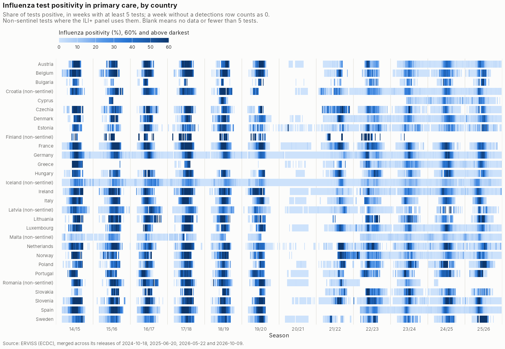

# Primary care test positivity for influenza

Data need from the [project one-pager](../../README.md#data-needs): *primary care test positivity for
flu [season, country, week]*.

**Source.** ERVISS (ECDC), file `sentinelTestsDetectionsPositivity.csv`. It holds weekly influenza
tests, detections and positivity for swabs taken from patients seen in sentinel primary-care networks,
by type and subtype.

**Search scope.** Only ERVISS was used. No wider search has been done for this data need.

**What is here.** Merged across ERVISS's releases, the series reach back to **2014/15**, as the ILI
rates do.

## Files

| File | Contents |
|---|---|
| [`erviss_detections_sentinel_merged.csv`](erviss_detections_sentinel_merged.csv) | **The extended series:** sentinel influenza tests, detections and positivity from 2014-W40 to 2026-W40, merged across ERVISS releases |
| [`erviss_detections_nonsentinel_merged.csv`](erviss_detections_nonsentinel_merged.csv) | The same for ERVISS `nonSentinelTestsDetections.csv`: tests and detections from other sources, mostly hospital laboratories |
| [`erviss_detections_sentinel.csv`](erviss_detections_sentinel.csv), [`erviss_detections_nonsentinel.csv`](erviss_detections_nonsentinel.csv) | The analysis pipeline's snapshots, byte-identical to ERVISS's release of 2026-05-22 (2021-W25 to 2026-W20). They cover influenza, SARS-CoV-2 and RSV. |
| [`coverage_by_country_season.csv`](coverage_by_country_season.csv) | Weeks with at least one influenza test, per country, season and stream |
| `figures/positivity_by_country.png` | The figure above |

**Layout of the data files.** All four share ERVISS's columns, `survtype, countryname, yearweek,
pathogen, pathogentype, pathogensubtype, indicator, age, value`.
- **Indicators:** `tests`, `detections`, `positivity`.
- **Ages:** all ages only.
- **Merged files:** influenza rows only, with two extra columns, `release` and `dropped_later`, as for
  the [ILI rates](../primary_care_ili_rates/README.md#files).

**Loading.** [`load_data.R`](../../code/01_main_supporting/load_data.R) loads the snapshots as
`data$epi$erviss_typing_sentinel` and `data$epi$erviss_typing_nonsentinel`. The merged files are not
used by the pipeline yet.

**How the ILI+ panel uses positivity.** The panel takes positivity as detections ÷ tests from the
**sentinel** stream. For Croatia, Finland, Iceland, Latvia, Malta and Romania it uses the
**non-sentinel** stream instead (see
[`stitch_iliplus.R`](../../code/01_main_supporting/stitch_iliplus.R)). RespiCompass made the same
choice for the same six countries. Whether that is right is
[open question 4](../../documentation/to_confirm_with_surveillance.md).

## How the merged series was built

The method is the same as for the ILI rates, with the same four ERVISS releases; see
[that README](../primary_care_ili_rates/README.md#how-the-merged-series-was-built). The script is
[`merge_releases.py`](../../code/09_erviss_history/merge_releases.py).

**Checks**
- **Revisions:** between releases, 2.1% of shared values changed by more than 5% in the sentinel
  stream and 3.0% in the non-sentinel stream.
- **Values only older releases carry:** 228 sentinel values (96 of them Czechia's) and 533
  non-sentinel values (418 of them the EU/EEA aggregate's) sit in weeks that newer releases no longer
  carry. They are marked `dropped_later = TRUE`.

## Coverage

Seasons with at least 20 weeks of one or more influenza tests, 2014/15 to 2025/26. The median counts
tests in a winter week (weeks 40–20), over all seasons. An asterisk marks the countries whose ILI+
uses the non-sentinel stream.

| Country | Sentinel: seasons | Sentinel tests, median | Non-sentinel: seasons | Non-sentinel tests, median |
|---|---|---:|---|---:|
| Austria | 11 (2014/15–2019/20, 2021/22–2025/26) | 72 | 12 (2014/15–2025/26) | 343 |
| Belgium | 11 (2014/15–2019/20, 2021/22–2025/26) | 13 | 0 | 1 |
| Bulgaria | 4 (2018/19, 2022/23–2024/25) | 1 | 12 (2014/15–2025/26) | 23 |
| Croatia * | 2 (2020/21–2021/22) | 0 | 11 (2014/15–2018/19, 2020/21–2025/26) | 226 |
| Cyprus | 4 (2018/19, 2023/24–2025/26) | 19 | 3 (2016/17–2018/19) | 0 |
| Czechia | 11 (2014/15–2019/20, 2021/22–2025/26) | 25 | 11 (2014/15–2019/20, 2021/22–2025/26) | 125 |
| Denmark | 12 (2014/15–2025/26) | 26 | 12 (2014/15–2025/26) | 2589 |
| Estonia | 12 (2014/15–2025/26) | 17 | 12 (2014/15–2025/26) | 159 |
| Finland * | 9 (2014/15–2022/23) | 5 | 7 (2014/15–2019/20, 2022/23) | 2 |
| France | 12 (2014/15–2025/26) | 78 | 12 (2014/15–2025/26) | 6216 |
| Germany | 12 (2014/15–2025/26) | 131 | 10 (2016/17–2025/26) | 16 |
| Greece | 7 (2014/15, 2020/21–2025/26) | 6 | 9 (2014/15–2019/20, 2021/22–2023/24) | 16 |
| Hungary | 12 (2014/15–2025/26) | 28 | 10 (2014/15–2020/21, 2023/24–2025/26) | 17 |
| Iceland * | 0 | 0 | 12 (2014/15–2025/26) | 129 |
| Ireland | 12 (2014/15–2025/26) | 47 | 12 (2014/15–2025/26) | 265 |
| Italy | 12 (2014/15–2025/26) | 99 | 12 (2014/15–2025/26) | 539 |
| Latvia * | 0 | 0 | 12 (2014/15–2025/26) | 67 |
| Lithuania | 10 (2014/15–2019/20, 2022/23–2025/26) | 8 | 11 (2014/15–2019/20, 2021/22–2025/26) | 16 |
| Luxembourg | 11 (2014/15–2015/16, 2017/18–2025/26) | 37 | 6 (2014/15–2017/18, 2019/20–2020/21) | 2 |
| Malta * | 1 (2022/23) | 0 | 9 (2014/15–2018/19, 2022/23–2025/26) | 290 |
| Netherlands | 12 (2014/15–2025/26) | 18 | 4 (2014/15–2017/18) | 98 |
| Norway | 11 (2014/15–2019/20, 2021/22–2025/26) | 14 | 12 (2014/15–2025/26) | 5356 |
| Poland | 11 (2014/15–2019/20, 2021/22–2025/26) | 17 | 12 (2014/15–2025/26) | 64 |
| Portugal | 12 (2014/15–2025/26) | 14 | 12 (2014/15–2025/26) | 1002 |
| Romania * | 8 (2014/15–2020/21, 2023/24) | 5 | 9 (2014/15–2021/22, 2023/24) | 70 |
| Slovakia | 10 (2014/15–2018/19, 2021/22–2025/26) | 7 | 12 (2014/15–2025/26) | 22 |
| Slovenia | 12 (2014/15–2025/26) | 19 | 12 (2014/15–2025/26) | 728 |
| Spain | 10 (2014/15–2019/20, 2022/23–2025/26) | 360 | 10 (2014/15–2019/20, 2022/23–2025/26) | 1058 |
| Sweden | 12 (2014/15–2025/26) | 19 | 12 (2014/15–2025/26) | 3966 |

**Reading the table**
- **Testing was winter-only before COVID-19:** a median of 30 sentinel-tested weeks a season, ending
  around season week 42. Most countries now test all year: 15 of 26 had at least 45 tested weeks in
  2023/24, against 3 in 2018/19. Pre-COVID-19 ILI+ can therefore only cover the winter, from ERVISS
  as from RespiCompass (see
  [the comparison](../primary_care_ili_rates/README.md#erviss-ili-against-respicompass-ili)).
- **Few sentinel tests:** Bulgaria, Finland, Greece, Lithuania, Romania and Slovakia have medians
  below 10 tests a week, so their weekly positivity is noisy.
- **No real sentinel stream:** Croatia, Iceland, Latvia and Malta have essentially none.

## Related

- [Primary care ILI rates](../primary_care_ili_rates/README.md): ILI+ is ILI rate × this positivity.
- [SARI test positivity](../sari_flu_positivity/README.md): the same measure among hospitalised SARI
  patients.
- [Open questions 1 and 4](../../documentation/to_confirm_with_surveillance.md): what an absent
  detections row means, and the choice of non-sentinel tests.
