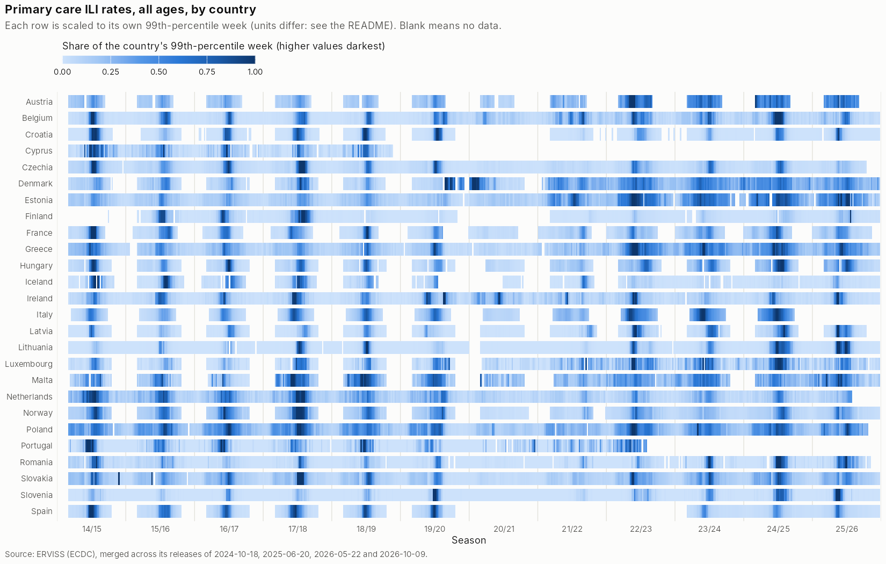

# Primary care ILI rates

Data need from the [project one-pager](../../README.md#data-needs): *primary care ILI rates
[season, country, week, age]*.

**Source.** ERVISS (ECDC), file
[`ILIARIRates.csv`](https://github.com/EU-ECDC/Respiratory_viruses_weekly_data/tree/main/data). It
holds weekly consultation rates for influenza-like illness (ILI) and acute respiratory infection (ARI)
from sentinel primary-care networks, by age group.

**Search scope.** Only ERVISS was used. No wider search has been done for this data need.

**What is here.** ERVISS publishes a rolling window of about four years, but it keeps every weekly
release. Merged across its releases, the series reach back to **2014/15**: 26 countries, most with 12
seasons.

## Files

| File | Contents |
|---|---|
| [`erviss_iliari_merged.csv`](erviss_iliari_merged.csv) | **The extended series**: ILI and ARI rates from 2014-W40 to 2026-W40, merged across ERVISS releases (see [How it was built](#how-the-merged-series-was-built)) |
| [`erviss_iliari.csv`](erviss_iliari.csv) | The analysis pipeline's snapshot, byte-identical to ERVISS's release of 2026-05-22 (2021-W25 to 2026-W20) |
| [`coverage_by_country_season.csv`](coverage_by_country_season.csv) | Weeks with ILI and with ARI rates, per country and season |
| [`iliplus_erviss_vs_respicompass.csv`](iliplus_erviss_vs_respicompass.csv) | ERVISS's own ILI+ against RespiCompass's, per country ([below](#erviss-ili-against-respicompass-ili)) |
| `figures/ili_rates_by_country.png` | The figure above |

**Layout of both data files.** They share ERVISS's columns, `survtype, countryname, yearweek,
indicator, age, value`.
- **Indicators:** `ILIconsultationrate` and `ARIconsultationrate`.
- **Ages:** `0-4, 5-14, 15-64, 65+, total`.
- **Extra columns in the merged file:**
  - `release`: which ERVISS release each value came from;
  - `dropped_later`: whether a newer release no longer carries that value.

**Loading.** [`load_data.R`](../../code/01_main_supporting/load_data.R) loads the snapshot as
`data$epi$erviss_ili_ari`. The pipeline and the ILI+ panel do not use the merged file yet; switching
them over would change the panel, so it is the owner's call.

**Units.** ERVISS reports rates per 100 000 population, with exceptions:
- Cyprus, Luxembourg and Malta: per 100 consultations;
- Finland: per 100 000 consultations.

The ILI+ panel multiplies Cyprus, Luxembourg and Malta by 1000. RespiCompass does the same for
Cyprus and Luxembourg; see the comparison below and
[open question 6](../../documentation/to_confirm_with_surveillance.md).

## How the merged series was built

ERVISS keeps each weekly release in its repository (`data/snapshots/`). The releases' windows changed
three times, which was found by opening the releases either side of each change:

| ERVISS releases | Window starts at |
|---|---|
| up to 2024-10-18 | 2014-W40 |
| 2024-10-25 to 2025-06-20 | 2020-W25 |
| 2025-06-27 to 2026-05-22 | 2021-W25 |
| 2026-08-07 to the current file (2026-10-09) | 2022-W25 |

**The rule.** [`merge_releases.py`](../../code/09_erviss_history/merge_releases.py) merges the last
release of each window with the current file. For every country, week, indicator and age group, it
keeps the value from the newest release that has one. Every week therefore carries its last-published
value. This is the same rule as for the
[hospital indicators](../flu_hospitalisation_indicators/README.md#1-erviss).

**Pinned inputs.** [`fetch_releases.sh`](../../code/09_erviss_history/fetch_releases.sh) pins the
ERVISS repository commit and the four releases.

**Rebuilding.** `bash code/09_erviss_history/build_all.sh <work_dir>` rebuilds everything here. A
rebuild from scratch reproduced the committed file exactly.

**Checks**
- **Revisions:** 2.3% of the values present in two releases changed by more than 5% between them.
- **Values only older releases carry:** 307 values sit in weeks that newer releases cover but no
  longer contain. They are kept and marked `dropped_later = TRUE`. 260 of them are Norway's 2023/24
  season. Whether ECDC withdrew them on purpose is not known, so filter on that column if in doubt.
- **A clear error in the source:** Slovakia's ILI rate for 2015-W51 is 155 763 per 100 000. The figure
  scales each row to its 99th-percentile week, so this week does not wash the row out. The value is
  left as published.

## Coverage

Seasons with at least 20 weeks of an all-age ILI rate, 2014/15 to 2025/26. Seasons run August to July.

| Country | Seasons | Of which before 2021/22, new here | By age |
|---|---|---|---|
| Austria | 12 (2014/15–2025/26) | 7 | yes |
| Belgium | 12 (2014/15–2025/26) | 7 | yes |
| Croatia | 11 (2014/15–2019/20, 2021/22–2025/26) | 6 | yes |
| Cyprus | 5 (2014/15–2018/19) | 5 | no |
| Czechia | 12 (2014/15–2025/26) | 7 | yes |
| Denmark | 12 (2014/15–2025/26) | 7 | yes |
| Estonia | 12 (2014/15–2025/26) | 7 | yes |
| Finland | 10 (2015/16–2019/20, 2021/22–2025/26) | 5 | yes |
| France | 12 (2014/15–2025/26) | 7 | yes |
| Greece | 12 (2014/15–2025/26) | 7 | from 2021/22 |
| Hungary | 12 (2014/15–2025/26) | 7 | no |
| Iceland | 10 (2014/15–2018/19, 2021/22–2025/26) | 5 | yes |
| Ireland | 12 (2014/15–2025/26) | 7 | yes |
| Italy | 11 (2014/15–2024/25) | 7 | yes |
| Latvia | 12 (2014/15–2025/26) | 7 | yes |
| Lithuania | 12 (2014/15–2025/26) | 7 | from 2021/22 |
| Luxembourg | 12 (2014/15–2025/26) | 7 | no |
| Malta | 12 (2014/15–2025/26) | 7 | yes |
| Netherlands | 12 (2014/15–2025/26) | 7 | yes |
| Norway | 12 (2014/15–2025/26) | 7 | yes |
| Poland | 12 (2014/15–2025/26) | 7 | yes |
| Portugal | 9 (2014/15–2022/23) | 7 | yes |
| Romania | 12 (2014/15–2025/26) | 7 | yes |
| Slovakia | 12 (2014/15–2025/26) | 7 | yes |
| Slovenia | 12 (2014/15–2025/26) | 7 | yes |
| Spain | 9 (2014/15–2019/20, 2023/24–2025/26) | 6 | yes |

**Who reports what.**
- **No ILI rates:** Bulgaria, Germany and Sweden do not report ILI rates to ERVISS.
- **Winter only:** Austria, Hungary, Italy and Latvia report only about 23–36 weeks a season,
  throughout.
- **Incomplete 2025/26:** it is still being reported, to 2026-W40 in the current release
  ([open question 5](../../documentation/to_confirm_with_surveillance.md)).

## ERVISS ILI+ against RespiCompass ILI+

For 2014/15–2023/24 the project's ILI+ panel uses RespiCompass's ILI+,
[`data_respicompass_iliplus.csv`](../data_respicompass_iliplus.csv). The merged releases make it
possible to rebuild that ILI+ from ERVISS itself: ILI rate × influenza detections ÷ tests, all ages.
[`compare_iliplus.py`](../../code/09_erviss_history/compare_iliplus.py) takes positivity from the
same test stream RespiCompass used for each row. RespiCompass used non-sentinel tests for exactly the
countries our panel does: Croatia, Finland, Iceland, Latvia, Malta and Romania.

**Results**, from [`iliplus_erviss_vs_respicompass.csv`](iliplus_erviss_vs_respicompass.csv):

| Group | Countries | RespiCompass / ERVISS | r |
|---|---|---|---|
| Identical | AT, BE, CZ, DK, EE, FR, GR, HU, IE, IT, LT, NL, NO, PL, PT, SI, SK, ES | 1.000 | 0.991–1.000 |
| Rescaled ×1000 | Cyprus, Luxembourg | exactly 1000 | 1.000 |
| Malta | | 942 | 0.92 |
| Non-sentinel countries | Croatia, Iceland, Romania | 0.94–0.98 | ≥ 0.999 |
| Finland | | 0.43 | 0.96 |
| Latvia | | 0.98 | 0.21 |

**What the groups mean**
- **Identical:** RespiCompass's ILI+ is ERVISS's ILI rate × positivity. Where fewer than all weeks
  agree to within 1%, the difference is ERVISS's later revisions. Belgium agrees on 60% of weeks and
  Denmark on 70%.
- **Rescaled ×1000:** RespiCompass applies the same rescaling our panel does.
- **Malta:** not a plain rescaling.
- **Non-sentinel countries:** the scale is close but individual weeks differ.
- **Finland and Latvia:** the two sources differ substantially and should be checked before either
  is trusted.

**The two sources cover the same weeks.** Before COVID-19, sentinel testing ran in winter only: a
median of 30 tested weeks a season, the last around season week 42. ERVISS's own ILI+ therefore stops
where RespiCompass's does, at a median of season week 41. ILI rates were reported almost all year, at
a median of 43 weeks. This is evidence for
[open question 3](../../documentation/to_confirm_with_surveillance.md): the pre-COVID-19 series end
where testing ended, not because our copy was cut short.

**What this offers.** For most countries, ERVISS could replace RespiCompass for 2014/15–2023/24 with
identical numbers and one source throughout. It would add age groups and ARI rates, and the
2023/24 alignment step between the two sources would no longer be needed. Switching would change the
panel, so it is left as an option.

## Related

- [Primary care test positivity](../primary_care_flu_positivity/README.md): the other half of ILI+,
  merged the same way.
- [Open questions about these data](../../documentation/to_confirm_with_surveillance.md).
